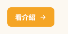
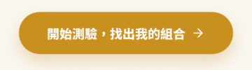
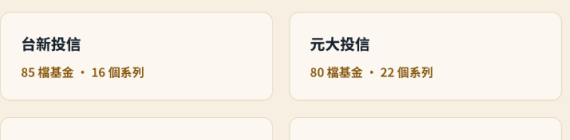
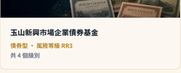
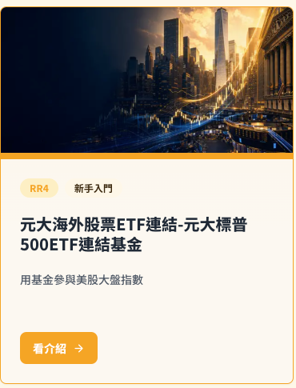
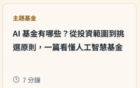

# Component Inventory

Inventory repeated components and UI, graphic, layout, and typographic patterns from the references.

| Component | Seen in | Status | Priority | Fingerprint summary | Required tokens | Missing states / modes | Notes |
|---|---|---|---|---|---|---|---|
| site-header | S1,S2,S3 | extracted | High | logo 左＋8 項導覽＋全圓角搜尋框；底部 1px 邊線 | surface、outline、on-background、surface-bright、corner-full | hover／active（目前頁）／focus 未見於稿 | 導覽項因欄寬不足造成 2 字換行（「首/頁」），屬瑕疵；spec: `components/site-header.md` |
| fund-company-card | S1,S2 | extracted | High | 頭圖＋公司簡稱＋法人全名＋「N 檔基金・M 個系列」；3 欄 | surface-bright、corner-md、text-link、text-tertiary | hover／focus 未見 | 首頁的精簡版（無頭圖）與總覽頁完整版待決定是否為 variant；spec: `components/fund-company-card.md` |
| button | S1,S3 | planned | High | 4 種：金色實心大按鈕（開始測驗）、琥珀小按鈕（看介紹）、深藍實心（閱讀完整指南）、描邊（看全部文章） | primary、secondary、inverse、outline | hover／pressed／disabled／focus 全缺 | **需決定主按鈕色（金 vs 琥珀）**，見 Similarity Review |
| fund-card | S1,S3,S4 | planned | High | 頭圖＋名稱＋RR／類型 meta＋（類別頁含 chip 與按鈕） | surface、corner-md、category-* | 空圖狀態（S4、S5 大量空白佔位） | 首頁精選與分類頁卡片差異大，見 Similarity Review |
| article-card | S1 | planned | Medium | 金色小標＋標題＋閱讀時間；4 欄 | surface、text-link | — | 無圖片，與 fund-card 結構不同 |
| category-hero | S3,S4,S5 | planned | High | breadcrumb＋badge＋H1＋副標＋適合對象面板＋漸層背景 | category-*、gold-* | — | 每類別換色；新手入門用琥珀、其他用藍／綠 |
| risk-chip（RR 標示） | S3 | planned | High | 金色小 chip「RR4」，淡金底 | accent-container、on-accent-container | 各風險等級 RR1–RR5 的色彩規則未見（皆同色） | 金融關鍵元件，需設計 RR 語意（避免紅綠暗示報酬） |
| quiz-hero（快問快答） | S1 | planned | High | pill 標籤＋標題＋說明＋IP 輪播＋主 CTA＋免責小字 | primary、surface-bright | 選項／結果頁未在稿中 | 核心轉換區 |
| ip-avatar-carousel | S1,S8 | planned | Medium | 6 張白框圓角卡，內為 3D 公仔 | surface-bright、corner-md | — | 圖像素材，IP 尚未定案 |
| topic-feature | S1 | planned | Medium | 金色小標＋大標＋內文＋深色按鈕＋3 張連結卡 | surface-band、inverse | — | — |
| site-footer | S1,S2,S3 | planned | Medium | 品牌＋說明＋3 欄連結＋免責聲明 | surface-band、text-link | — | 免責文字為金融合規必要資訊 |
| breadcrumb | S2,S3 | planned | Low | 金色首頁連結＋「›」＋灰藍目前頁 | text-link、text-tertiary | — | — |
| fund-article-detail | S9 | blocked | Medium | 基金學堂內頁（3:4） | — | — | 本輪未擷取，無證據 |

Status values: `extracted`, `planned`, `blocked`, `out-of-scope`.

## Component Similarity Review

Use this table when a newly observed component is visually, structurally, behaviorally, or compositionally close to an existing component. Stop and confirm unresolved rows before creating another component spec.

| New candidate | Similar existing component | Visual reference | Similarity reason | Suggested action | Developer decision (`merge` / `make variant` / `keep distinct` / `blocked`) | Rationale / owner |
|---|---|---|---|---|---|---|
| button（琥珀「看介紹」） | button（金色「開始測驗」） |   | 同為主要動作，色相相近但 #F5A525 與 #C8901F 不同；尺寸與圓角不同 | make variant（建議：size=lg／md；色彩先收斂為單一 primary） | blocked（待開發者決定，pending developer） | 需先決定品牌主 CTA 色 |
| fund-company-card（首頁精簡版） | fund-company-card（總覽頁完整版） |   | 同為公司入口卡片；首頁版無頭圖、4 欄，總覽版有頭圖、3 欄 | make variant（density=compact） | blocked（待開發者決定，pending developer） | — |
| fund-card（分類頁） | fund-card（首頁精選） |   | 同為基金卡；分類頁多了 chip＋按鈕＋頂部色條 | make variant | blocked（待開發者決定，pending developer） | 首頁卡片資訊較少（無按鈕） |
| article-card | fund-card |  | 皆為卡片容器，但文章卡無圖、用途不同 | keep distinct | blocked（待開發者決定，pending developer） | 內容結構不同 |

Visual references must point to source-based previews when available, such as actual Figma node screenshots or screenshot crops saved under `assets/component-review/`. A schematic SVG is allowed only as a last-resort fallback when source previews cannot be captured, and it must be labeled `schematic fallback - source preview unavailable`.
